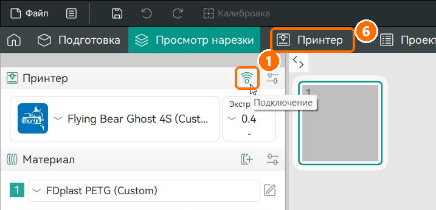
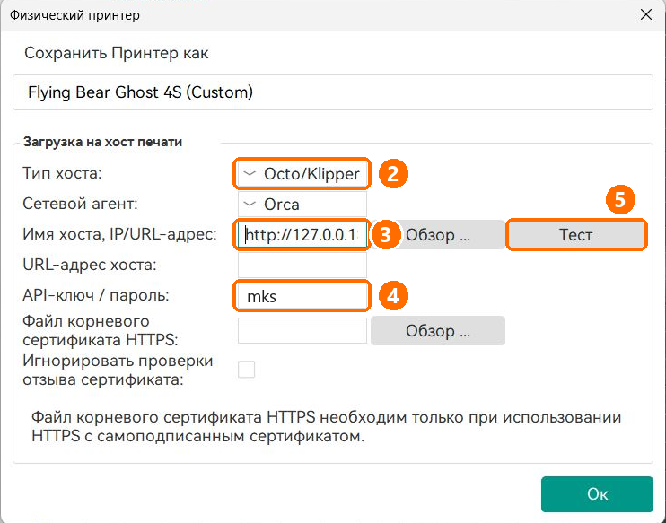
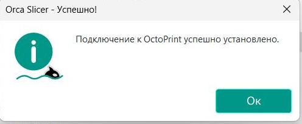
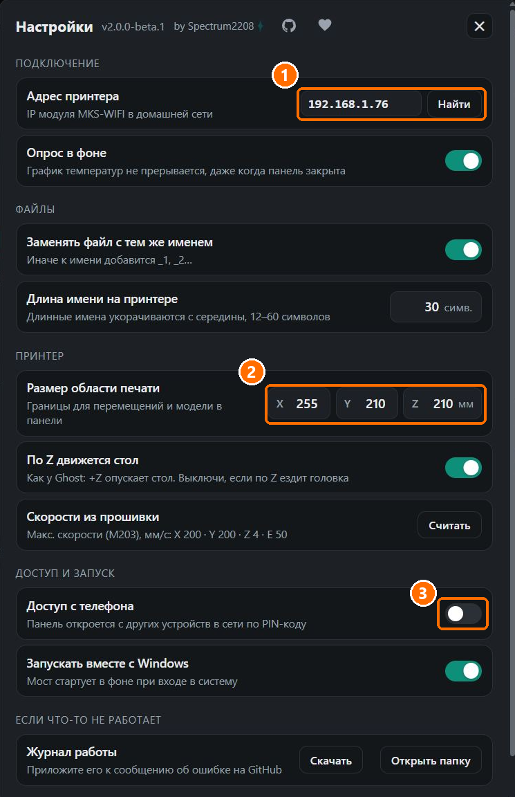

# MKS WiFi Bridge

**Русский** · [English](#english)

Мост между **OrcaSlicer** и 3D-принтерами с модулем **MKS-WIFI** (Flying Bear Ghost 4S и другие принтеры на платах MKS).
Отправляйте печать прямо из слайсера по Wi-Fi и следите за ней в веб-панели — с компьютера или телефона.


## Как я докатился до жизни такой

Я хотел, чтобы мой Ghost 4S принимал задания из Orca по Wi-Fi. Нашёл только [скрипт пост-обработки для PrusaSlicer](https://github.com/ArtificalSUN/MKS-WIFI_PS_uploader)
четырёхлетней давности — спасибо его автору, но по удобству и функционалу он меня не устроил. Решил сделать своё, под Orca…
и *немножко* увлёкся: сверху появились веб-панель, живая схема принтера, модель печати, график температур
и голова, нарисованная по чертежам E3D.

## Возможности

### Печать из OrcaSlicer
- Эмуляция OctoPrint API: в Orca тип хоста Octo/Klipper, без плагинов и скриптов пост-обработки.
- Заливка по HTTP: до 3 попыток, проверка файла на карте, удаление недокачанного.
- Запуск печати сразу после заливки.
- Транслитерация кириллицы, укорачивание имён под экран принтера (12–60 символов), замена или нумерация одноимённых файлов.
- Эскиз модели для стоковых экранов MKS: PNG из G-code переводится в формат MKS (50 или 100 px и 200 px).

### Веб-панель
- Схема принтера сверху и спереди в масштабе стола; движение головы с ускорениями и скоростями из прошивки.
- Модель по G-code: текущий слой — все линии экструзии, остальные — контуры, спереди — силуэт напечатанного.
- Экструдер в разрезе: E3D V6 и BMG по чертежам производителя, передаточное отношение 50:17.
- Прогресс по позиции Marlin в файле: слой, процент, прошедшее и оставшееся время, время окончания.
- Обдув модели по командам M106/M107 из G-code.
- График температур сопла и стола за 5, 15 и 60 минут; запись в фоне при закрытой панели.

### Управление
- Перемещение кликом по схеме, шаг 0,1–50 мм, парковка, отключение моторов.
- Нагрев и остывание, подача и втягивание прутка, обдув 0–100 %.
- Файлы на карте: список, печать, удаление.
- G-code консоль с историей и справочником из 39 команд Marlin и MKS.

### Работа с MKS-WIFI
- Учёт устаревших ответов модуля во время печати: состояние, прогресс и температуры берутся у Marlin.
- Одно TCP-соединение на принтер: опрос уступает его командам, во время заливки принтер не опрашивается.
- Блокировка движения, парковки и удаления файлов во время печати.
- Поиск принтера в локальной сети, переподключение при смене IP.

### Запуск и доступ
- Windows: готовый `.exe`, значок в трее, автозапуск.
- Исходники: Python 3.10+, только стандартная библиотека.
- Панель во вкладке «Принтер» в Orca, в браузере, с телефона по PIN-коду.
- Журнал работы с ротацией, выгрузка в один клик.

> ⚠️ **Используйте на свой страх и риск.** Мост проверен на одном принтере — моём. Он отправляет на принтер файлы
> и команды, включая нагрев и движение осей. Автор не несёт ответственности за испорченную печать, принтер, плату,
> прошивку, имущество или что-либо ещё. Как и с любой печатью — не оставляйте принтер без присмотра.

## Установка

### Вариант 1: готовая программа (Windows)

1. Скачайте `MKSBridge.exe` из раздела [Releases](../../releases).
2. Запустите. Windows может предупредить о неизвестном издателе («Windows защитила ваш компьютер») — нажмите «Подробнее» → «Выполнить в любом случае».
3. Откроется панель `http://127.0.0.1:5000`, мост сам поищет принтер в сети. Значок моста появится в трее.

### Вариант 2: из исходников

Нужен Python 3.10 или новее (проверено на 3.13). Дополнительные пакеты не нужны.

```
git clone https://github.com/Spectrum2208/MKS-WiFi-Bridge.git
cd MKS-WiFi-Bridge
python run_bridge.py
```

Значок в трее появится, если установлены необязательные пакеты: `pip install pystray pillow`. Без них всё работает, просто без значка.

## Настройка OrcaSlicer

1. Нажмите значок Wi-Fi («Подключение») рядом с именем принтера — откроется окно «Физический принтер».

   

2. **Тип хоста:** `Octo/Klipper`.
3. **Имя хоста, IP/URL-адрес:** `http://127.0.0.1:5000`.
4. **API-ключ:** любой непустой текст, например `2208`.
5. Нажмите «Тест».

   

   Должно появиться сообщение об успешном подключении:

   

6. Нажмите «Ок». Теперь кнопка «Отправить» / «Печать» в Orca отправляет файл на принтер через мост,
   а вкладка **«Принтер»** вверху окна Orca (**6** на первой картинке) показывает веб-панель.

**Картинка модели на экране принтера** (для стоковых экранов MKS; Color UI и другие экраны, которые рисует сам Marlin, картинок не показывают).
В Orca: настройки принтера → «Основная информация» → «Эскизы в G-коде», впишите, например, `300x300/PNG`.
В панели: настройки → «Картинка модели на экране» → ваш принтер (**3** на картинке ниже). Мост уменьшит эскиз до нужных размеров сам.

## Первый запуск

- Мост сам ищет принтер в локальной сети. Если не нашёл — откройте настройки панели (значок справа вверху) и нажмите «Найти принтер» или впишите IP вручную.
- В настройках задаются размеры стола, длина имени файла на экране принтера, автозапуск вместе с Windows и доступ с телефона.
- Настройки и журнал лежат в `%APPDATA%\MKSBridge\`.



**1** — адрес принтера и кнопка «Найти», **2** — размеры области печати вашего принтера, **3** — картинка модели для экрана принтера, **4** — доступ с телефона.

### Параметры командной строки

```
MKSBridge.exe [--ip АДРЕС] [--port 5000] [--no-tray] [--no-browser]
```

`--ip` — адрес принтера, `--port` — порт панели. Указанные значения запоминаются в настройках.

## Если что-то не работает

- **Windows спрашивает про брандмауэр** при первом запуске. Разрешите доступ для частных сетей — тогда панель откроется и с телефона. Если отказать, с этого компьютера всё работает, а с телефона нет.
- **Антивирус ругается на `MKSBridge.exe`.** Программы, собранные PyInstaller, иногда получают ложные срабатывания. Можно запустить мост из исходников (вариант 2) — это тот же код.
- **Мост не находит принтер.** Принтер и компьютер должны быть в одной сети (не в гостевой). Если сеть устроена сложнее обычной домашней, впишите IP принтера вручную в настройках панели — его показывает экран принтера в разделе Wi-Fi.
- **«Порт 5000 занят другой программой».** Запустите мост с другим портом (`--port 5001`) и укажите этот же порт в Orca.
- **Панель пишет «Мост не отвечает».** Программа закрыта — запустите её снова, панель подключится сама.

## Как сообщить об ошибке

1. Откройте настройки панели → раздел «Если что-то не работает» → **«Скачать»** журнал
   (или «Открыть папку» — журнал лежит в `%APPDATA%\MKSBridge\mks_bridge.log`).
2. Создайте сообщение в [Issues](../../issues): что делали, что ожидали, что получилось, модель принтера.
3. Приложите файл журнала. В нём нет паролей и PIN-кода — только работа моста, ответы принтера и названия файлов.

## На чём проверено

Flying Bear Ghost 4S с прошивкой [Marlin_FB4S](https://github.com/Sergey1560/Marlin_FB4S) (ветка `FB4S_WIFI`, Marlin 2.1.2) и модулем MKS-WIFI. Эту прошивку ставят многие владельцы Ghost 4S и 5 — если у вас она же, мост, скорее всего, заработает сразу. Другие принтеры с модулем MKS-WIFI (Ghost 5, Ghost 4S со стоковой прошивкой и т.д.) должны работать, но пока не проверены. Если у вас такой — напишите в [Issues](../../issues), получилось или нет: это лучшая помощь проекту.

Во время печати, запущенной по Wi-Fi, модуль MKS-WIFI отвечает на служебные запросы о состоянии из своей памяти, и эти ответы устаревают: «принтер свободен» при идущей печати, нулевой прогресс, застывшие температуры. Мост это учитывает: прогресс и слой берутся из ответов самого Marlin (`SD printing byte`), прошедшее время считается мостом, температуры обновляются через автоотчёт платы (`M155`).

## Известные ограничения

- Пока модуль принимает файл, принтер не отвечает на команды: панель показывает «Загрузка файла» и ждёт.
- Картинку для стоковых экранов MKS автор проверить не может (у автора Color UI): формат взят у плагина MKS WiFi для Cura. Если у вас стоковый экран — напишите в [Issues](../../issues), показалась ли картинка.
- Русские буквы в именах файлов прошивка не понимает, поэтому мост переводит имена в латиницу и укорачивает длинные — исходное имя видно в панели.
- Модуль MKS-WIFI держит одно соединение. Не открывайте одновременно другую программу, которая общается с принтером по Wi-Fi.
- Для Orca состояние принтера всегда «готов», даже во время печати. За печатью следите в панели.
- Размеры стола по умолчанию — от Ghost 4S (255 × 210 × 210 мм), поменяйте их в настройках под свой принтер.

## Планы

Без обещаний сроков — просто что хочется сделать дальше:

- английский интерфейс панели;
- схема для принтеров с подвижным столом (дрыгостолов);
- выбор хотэнда и экструдера в отрисовке головы;
- помощник ручной калибровки стола: винты стола на схеме под разные принтеры, объезд углов по клику;
- движение головы и подача прутка по G-code в реальном времени (?);
- своя сборка свежего Marlin для Ghost с модулем MKS-WIFI и шейперами MZV/EI, в паре с мостом (??).

## Участие

Сообщения об ошибках и идеи — в [Issues](../../issues). Пулл-реквесты приветствуются.
Отправляя пулл-реквест, вы соглашаетесь, что автор проекта может распространять ваш вклад на условиях лицензии проекта,
в том числе в рамках отдельного коммерческого разрешения.

## Поддержать проект

Если мост вам пригодился и хочется сказать спасибо монетой — [страница поддержки на CloudTips](https://pay.cloudtips.ru/p/865e681a).
Это добровольно: мост был и останется бесплатным. А звёздочка на GitHub и сообщение «работает на моём принтере» тоже очень радуют.

## Как сделан проект

Идея, требования, проверка на живом принтере и отладка — мои. Код написан вместе с Claude Code (ИИ-ассистент от Anthropic):
я ставил задачи, проверял результат на своём Ghost 4S и решал, что идёт в релиз.

## Лицензия

[PolyForm Noncommercial 1.0.0](LICENSE.md). Пользоваться, изучать, изменять и делиться можно бесплатно в некоммерческих целях.
Для коммерческого использования (продажа, включение в платный продукт или услугу) нужно разрешение автора — напишите через [Issues](../../issues).

by Spectrum2208

---

<a id="english"></a>

# MKS WiFi Bridge

[Русский](#mks-wifi-bridge) · **English**

A bridge between **OrcaSlicer** and 3D printers with the **MKS-WIFI** module (Flying Bear Ghost 4S and other printers with MKS boards).
Send prints straight from the slicer over Wi-Fi and watch them in a web dashboard — from your PC or phone.

## How I ended up here

I wanted my Ghost 4S to take jobs from Orca over Wi-Fi. All I found was a four-year-old [post-processing script for PrusaSlicer](https://github.com/ArtificalSUN/MKS-WIFI_PS_uploader)
— thanks to its author, but it didn't suit me in convenience or features. I decided to build my own, for Orca…
and got *slightly* carried away: on top came a web dashboard, a live printer diagram, the print model, a temperature chart
and a print head drawn from E3D's technical drawings.

## Features

### Printing from OrcaSlicer
- OctoPrint API emulation: host type Octo/Klipper in Orca, no plugins or post-processing scripts.
- HTTP upload: up to 3 attempts, file verified on the SD card, half-uploaded files removed.
- Print starts right after the upload.
- Cyrillic transliteration, names shortened for the printer screen (12–60 characters), same-name files replaced or numbered.
- Model thumbnail for stock MKS screens: the PNG from the G-code is converted to the MKS format (50 or 100 px and 200 px).

### Web dashboard
- Top and front printer views at your bed's scale; head motion with the accelerations and speeds from the firmware.
- Model from the G-code: the current layer with every extrusion line, other layers as outlines, a front silhouette of what's printed.
- Cutaway extruder: E3D V6 and BMG from manufacturer drawings, 50:17 gear ratio.
- Progress from Marlin's file position: layer, percent, time elapsed and left, finish time.
- Part cooling fan from the M106/M107 commands in the G-code.
- Nozzle and bed temperature chart over 5, 15 and 60 minutes; recorded in the background with the dashboard closed.

### Control
- Click-to-move on the diagram, 0.1–50 mm steps, homing, motors off.
- Heating and cooling, filament feed and retract, fan 0–100 %.
- SD card files: list, print, delete.
- G-code console with history and a reference of 39 Marlin and MKS commands.

### MKS-WIFI handling
- Stale module replies during a print are accounted for: state, progress and temperatures come from Marlin.
- One TCP connection to the printer: polling yields to commands, no polling during uploads.
- Moves, homing and file deletion blocked while printing.
- Printer discovery on the local network, reconnect after an IP change.

### Running and access
- Windows: ready-made `.exe`, tray icon, autostart.
- From source: Python 3.10+, standard library only.
- Dashboard in Orca's "Device" tab, in a browser, on a phone with a PIN code.
- Rotating log, one-click download.

> ⚠️ **Use at your own risk.** The bridge has been tested on one printer — mine. It sends files and commands to the
> printer, including heating and axis moves. The author is not responsible for failed prints, damage to the printer,
> board, firmware, property or anything else. As with any print, don't leave the printer unattended.

## Installation

### Option 1: ready-made program (Windows)

1. Download `MKSBridge.exe` from [Releases](../../releases).
2. Run it. Windows may warn about an unknown publisher ("Windows protected your PC") — click "More info" → "Run anyway".
3. The dashboard opens at `http://127.0.0.1:5000` and the bridge searches for the printer on your network. The bridge icon appears in the system tray.

### Option 2: from source

Requires Python 3.10 or newer (tested on 3.13). No extra packages needed.

```
git clone https://github.com/Spectrum2208/MKS-WiFi-Bridge.git
cd MKS-WiFi-Bridge
python run_bridge.py
```

The tray icon appears if the optional packages are installed: `pip install pystray pillow`. Everything works without them, just without the icon.

## OrcaSlicer setup

The screenshots show Orca in Russian; the numbers match the steps.

1. Click the Wi-Fi ("Connection") icon next to the printer name — the "Physical printer" window opens.

   

2. **Host type:** `Octo/Klipper`.
3. **Hostname, IP or URL:** `http://127.0.0.1:5000`.
4. **API key:** any non-empty text, e.g. `2208`.
5. Click "Test".

   

   You should see a "connected successfully" message:

   

6. Click "OK". Now the "Send" / "Print" button in Orca sends the file to the printer through the bridge,
   and Orca's **"Device"** tab at the top of the window (**6** in the first picture) shows the dashboard.

**Model picture on the printer screen** (for stock MKS screens; Color UI and other screens drawn by Marlin itself show no pictures).
In Orca: printer settings → "Basic information" → "G-code thumbnails", enter e.g. `300x300/PNG`.
In the dashboard: settings → "Картинка модели на экране" (model picture) → your printer (**3** in the picture below). The bridge resizes the thumbnail itself.

## First run

- The bridge searches for the printer on your local network. If it doesn't find it, open the dashboard settings (top-right icon) and click "Find printer" (Найти принтер), or enter the IP manually.
- The settings hold the bed size, the file name length for the printer screen, autostart with Windows and phone access.
- Settings and the log live in `%APPDATA%\MKSBridge\`.


**1** — printer address and the "Найти" (find) button, **2** — your printer's build volume, **3** — model picture for the printer screen, **4** — phone access.

### Command-line options

```
MKSBridge.exe [--ip ADDRESS] [--port 5000] [--no-tray] [--no-browser]
```

`--ip` is the printer address, `--port` is the dashboard port. Values given here are saved to the settings.

## Troubleshooting

- **Windows asks about the firewall** on first run. Allow access on private networks so the dashboard also opens on your phone. If you deny it, everything still works on this PC, just not from the phone.
- **Your antivirus flags `MKSBridge.exe`.** Programs built with PyInstaller sometimes get false positives. You can run the bridge from source instead (option 2) — it's the same code.
- **The bridge can't find the printer.** The printer and the PC must be on the same network (not a guest network). If your network is more complex than a typical home one, enter the printer's IP manually in the dashboard settings — the printer screen shows it in its Wi-Fi menu.
- **"Port 5000 is used by another program".** Start the bridge on another port (`--port 5001`) and use the same port in Orca.
- **The dashboard says "Мост не отвечает" (bridge not responding).** The program is closed — start it again and the dashboard reconnects by itself.

## Reporting a problem

1. Open the dashboard settings → the "Если что-то не работает" (troubleshooting) section → **"Скачать"** (download) the log
   (or "Открыть папку" to open its folder — the log is `%APPDATA%\MKSBridge\mks_bridge.log`).
2. Open an [issue](../../issues): what you did, what you expected, what happened, and your printer model.
3. Attach the log file. It contains no passwords or PIN — only what the bridge did, the printer's replies and file names.

## Tested on

Flying Bear Ghost 4S with the [Marlin_FB4S](https://github.com/Sergey1560/Marlin_FB4S) firmware (`FB4S_WIFI` branch, Marlin 2.1.2) and the MKS-WIFI module. Many Ghost 4S/5 owners run this firmware — if you do too, the bridge will most likely just work. Other printers with the MKS-WIFI module (Ghost 5, Ghost 4S with stock firmware, etc.) should work but haven't been tested yet. If you have one, please report in [Issues](../../issues) whether it works — that's the best way to help the project.

While a print started over Wi-Fi is running, the MKS-WIFI module answers status queries from its own memory, and those answers go stale: "idle" while printing, zero progress, frozen temperatures. The bridge accounts for this: progress and layer come from Marlin's own replies (`SD printing byte`), elapsed time is counted by the bridge, and temperatures are refreshed via the board's auto-report (`M155`).

## Known limitations

- While the module receives a file, the printer doesn't answer commands: the dashboard shows "Загрузка файла" (uploading) and waits.
- The author can't test the picture on stock MKS screens (the author's printer runs Color UI): the format is taken from the MKS WiFi plugin for Cura. If you have a stock screen, please report in [Issues](../../issues) whether the picture shows up.
- The firmware can't handle Cyrillic file names, so the bridge transliterates names and shortens long ones; the original name is shown in the dashboard.
- The MKS-WIFI module keeps a single connection. Don't run another program that talks to the printer over Wi-Fi at the same time.
- Orca always sees the printer as "ready", even while printing. Watch the print in the dashboard.
- The default bed size is the Ghost 4S one (255 × 210 × 210 mm); change it in the settings for your printer.

## Plans

No promised dates — just what I'd like to do next:

- an English dashboard interface (it's in Russian for now);
- a diagram for bed slinger printers (moving Y bed);
- a choice of hotend and extruder for the print head drawing;
- a manual bed leveling helper: bed screws on the diagram for different printers, click to visit each corner;
- live head movement and filament feed simulated from the G-code (?);
- a fresh Marlin build for the Ghost with MKS-WIFI support and MZV/EI shapers, paired with the bridge (??).

## Contributing

Bug reports and ideas go to [Issues](../../issues). Pull requests are welcome.
By submitting a pull request you agree that the project author may distribute your contribution under the project license,
including under a separate commercial permission.

## Support the project

If the bridge helped you and you'd like to say thanks with a coin — [support page on CloudTips](https://pay.cloudtips.ru/p/865e681a).
It's entirely optional: the bridge is and will stay free. A star on GitHub or a "works on my printer" note makes my day too.

## How it was made

The idea, the requirements, testing on a real printer and debugging are mine. The code was written together with Claude Code
(an AI assistant by Anthropic): I set the tasks, checked the results on my Ghost 4S and decided what goes into a release.

## License

[PolyForm Noncommercial 1.0.0](LICENSE.md). You may use, study, modify and share it for free for noncommercial purposes.
Commercial use (selling it, including it in a paid product or service) requires the author's permission — get in touch via [Issues](../../issues).

by Spectrum2208
