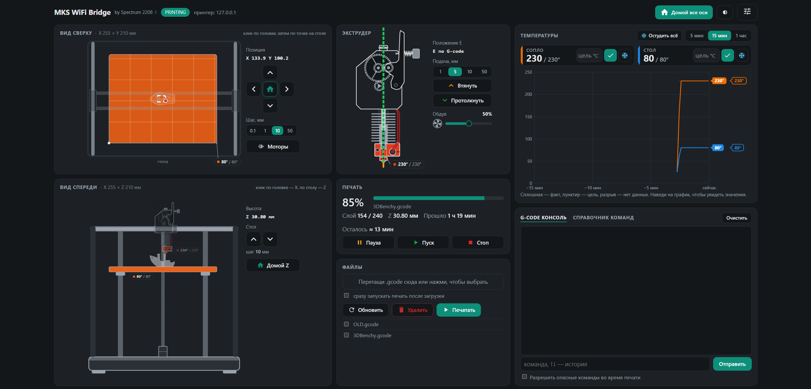

# MKS WiFi Bridge

**Русский** · [English](#english)

Мост между **OrcaSlicer** и 3D-принтерами с модулем **MKS-WIFI** (Flying Bear Ghost 4S и другие принтеры на платах MKS).
Отправляйте печать прямо из слайсера по Wi-Fi и следите за ней в веб-панели — с компьютера или телефона.



## Как я докатился до жизни такой

Я хотел, чтобы мой Ghost 4S принимал задания из Orca по Wi-Fi. Нашёл только [скрипт пост-обработки для PrusaSlicer](https://github.com/ArtificalSUN/MKS-WIFI_PS_uploader)
четырёхлетней давности — спасибо его автору, с него всё началось. Решил сделать своё, под Orca и поудобнее…
и *немножко* увлёкся: сверху появились веб-панель, живая схема принтера, модель печати, график температур
и голова, нарисованная по чертежам E3D.

## Возможности

- **Печать из Orca одной кнопкой.** Мост притворяется сервером OctoPrint: Orca отправляет файл как обычно, мост заливает его на карту принтера и, если нужно, запускает печать.
- **Веб-панель с живой схемой принтера:** вид сверху и спереди, положение головы, текущий слой модели, температуры с графиком, прогресс, время до конца, обдув.
- **Управление:** перемещение осей кликом по схеме, парковка, нагрев, подача прутка, обдув, файлы на карте, G-code консоль со справочником команд.
- **Защита от ошибок:** во время печати опасные команды (движение, парковка, удаление файлов) заблокированы.
- **Сам находит принтер в сети** и переподключается, если роутер выдал ему другой адрес.
- **Доступ с телефона** по PIN-коду (включается в настройках).
- **Без установки зависимостей:** готовый `.exe` или Python без дополнительных пакетов.

## Установка

### Вариант 1: готовая программа (Windows)

1. Скачайте `MKSBridge.exe` из раздела [Releases](../../releases).
2. Запустите. Windows может предупредить о неизвестном издателе («Windows защитила ваш компьютер») — нажмите «Подробнее» → «Выполнить в любом случае».
3. Откроется панель `http://127.0.0.1:5000`, мост сам поищет принтер в сети. Значок моста появится в трее.

### Вариант 2: из исходников

Нужен Python 3.10 или новее (проверено на 3.13). Дополнительные пакеты не нужны.

```
git clone https://github.com/Spectrum2208/mks-wifi-bridge.git
cd mks-wifi-bridge
python run_bridge.py
```

Значок в трее появится, если установлены необязательные пакеты: `pip install pystray pillow`. Без них всё работает, просто без значка.

## Настройка OrcaSlicer

1. В Orca откройте настройки принтера → значок Wi-Fi рядом с именем принтера («Физический принтер»).
2. **Тип хоста:** `Octo/Klipper`.
3. **Адрес:** `http://127.0.0.1:5000`.
4. **API-ключ:** любой непустой текст, например `mks`.
5. Нажмите «Тест» — Orca должна подключиться.

Теперь кнопка «Отправить» / «Печать» в Orca отправляет файл на принтер через мост. Вкладка «Принтер» (Device) в Orca показывает веб-панель.

## Первый запуск

- Мост сам ищет принтер в локальной сети. Если не нашёл — откройте настройки панели (значок справа вверху) и нажмите «Найти принтер» или впишите IP вручную.
- В настройках задаются размеры стола, длина имени файла на экране принтера, автозапуск вместе с Windows и доступ с телефона.
- Настройки и журнал лежат в `%APPDATA%\MKSBridge\`.

### Параметры командной строки

```
MKSBridge.exe [--ip АДРЕС] [--port 5000] [--no-tray] [--no-browser]
```

`--ip` — адрес принтера, `--port` — порт панели. Указанные значения запоминаются в настройках.

## Если что-то не работает

- **Windows спрашивает про брандмауэр** при первом запуске. Разрешите доступ для частных сетей — тогда панель откроется и с телефона. Если отказать, с этого компьютера всё работает, а с телефона нет.
- **Антивирус ругается на `MKSBridge.exe`.** Программы, собранные PyInstaller, иногда получают ложные срабатывания. Можно запустить мост из исходников (вариант 2) — это тот же код.
- **Мост не находит принтер.** Принтер и компьютер должны быть в одной сети (не в гостевой). Если сеть устроена сложнее обычной домашней, впишите IP принтера вручную в настройках панели — его показывает экран принтера в разделе Wi-Fi.
- **«Порт 5000 занят другой программой».** Запустите мост с другим портом (`--port 5001`) и укажите этот же порт в Orca.
- **Панель пишет «Мост не отвечает».** Программа закрыта — запустите её снова, панель подключится сама.

## Как сообщить об ошибке

1. Откройте настройки панели → раздел «Если что-то не работает» → **«Скачать»** журнал
   (или «Открыть папку» — журнал лежит в `%APPDATA%\MKSBridge\mks_bridge.log`).
2. Создайте сообщение в [Issues](../../issues): что делали, что ожидали, что получилось, модель принтера.
3. Приложите файл журнала. В нём нет паролей и PIN-кода — только работа моста, ответы принтера и названия файлов.

## На чём проверено

Flying Bear Ghost 4S с прошивкой [Marlin_FB4S](https://github.com/Sergey1560/Marlin_FB4S) (ветка `FB4S_WIFI`, Marlin 2.1.2) и модулем MKS-WIFI. Эту прошивку ставят многие владельцы Ghost 4S и 5 — если у вас она же, мост, скорее всего, заработает сразу. Другие принтеры с модулем MKS-WIFI (Ghost 5, Ghost 4S со стоковой прошивкой и т.д.) должны работать, но пока не проверены. Если у вас такой — напишите в [Issues](../../issues), получилось или нет: это лучшая помощь проекту.

Во время печати, запущенной по Wi-Fi, модуль MKS-WIFI отвечает на служебные запросы о состоянии из своей памяти, и эти ответы устаревают: «принтер свободен» при идущей печати, нулевой прогресс, застывшие температуры. Мост это учитывает: прогресс и слой берутся из ответов самого Marlin (`SD printing byte`), прошедшее время считается мостом, температуры обновляются через автоотчёт платы (`M155`).

## Известные ограничения

- Пока модуль принимает файл, принтер не отвечает на команды: панель показывает «Загрузка файла» и ждёт.
- Русские буквы в именах файлов прошивка не понимает, поэтому мост переводит имена в латиницу и укорачивает длинные — исходное имя видно в панели.
- Модуль MKS-WIFI держит одно соединение. Не открывайте одновременно другую программу, которая общается с принтером по Wi-Fi.
- Для Orca состояние принтера всегда «готов», даже во время печати. За печатью следите в панели.
- Размеры стола по умолчанию — от Ghost 4S (255 × 210 × 210 мм), поменяйте их в настройках под свой принтер.

## Участие

Сообщения об ошибках и идеи — в [Issues](../../issues). Пулл-реквесты приветствуются.
Отправляя пулл-реквест, вы соглашаетесь, что автор проекта может распространять ваш вклад на условиях лицензии проекта,
в том числе в рамках отдельного коммерческого разрешения.

## Поддержать проект

Если мост вам пригодился и хочется сказать спасибо монетой — [страница поддержки на CloudTips](https://pay.cloudtips.ru/p/865e681a).
Это добровольно: мост был и останется бесплатным. А звёздочка на GitHub и сообщение «работает на моём принтере» тоже очень радуют.

## Лицензия

[PolyForm Noncommercial 1.0.0](LICENSE.md). Пользоваться, изучать, изменять и делиться можно бесплатно в некоммерческих целях.
Для коммерческого использования (продажа, включение в платный продукт или услугу) нужно разрешение автора — напишите через [Issues](../../issues).

by Spectrum2208

---

<a id="english"></a>

# MKS WiFi Bridge

[Русский](#mks-wifi-bridge) · **English**

A bridge between **OrcaSlicer** and 3D printers with the **MKS-WIFI** module (Flying Bear Ghost 4S and other printers with MKS boards).
Send prints straight from the slicer over Wi-Fi and watch them in a web dashboard — from your PC or phone.

## How I ended up here

I wanted my Ghost 4S to take jobs from Orca over Wi-Fi. All I found was a four-year-old [post-processing script for PrusaSlicer](https://github.com/ArtificalSUN/MKS-WIFI_PS_uploader)
— thanks to its author, that's where it all started. I decided to build my own, for Orca and a bit nicer…
and got *slightly* carried away: on top came a web dashboard, a live printer diagram, the print model, a temperature chart
and a print head drawn from E3D's technical drawings.

## Features

- **One-click printing from Orca.** The bridge pretends to be an OctoPrint server: Orca sends the file as usual, the bridge uploads it to the printer's SD card and starts the print if asked.
- **Web dashboard with a live printer diagram:** top and front views, head position, the current layer of the model, temperatures with a chart, progress, time left, part cooling fan.
- **Control:** move axes by clicking the diagram, homing, heating, filament feed, fan, SD card files, a G-code console with a command reference.
- **Safety:** dangerous commands (moves, homing, file deletion) are blocked while printing.
- **Finds the printer on the network by itself** and reconnects if the router gives it a new address.
- **Phone access** with a PIN code (enable it in the settings).
- **No dependencies to install:** a ready-made `.exe`, or plain Python with no extra packages.

## Installation

### Option 1: ready-made program (Windows)

1. Download `MKSBridge.exe` from [Releases](../../releases).
2. Run it. Windows may warn about an unknown publisher ("Windows protected your PC") — click "More info" → "Run anyway".
3. The dashboard opens at `http://127.0.0.1:5000` and the bridge searches for the printer on your network. The bridge icon appears in the system tray.

### Option 2: from source

Requires Python 3.10 or newer (tested on 3.13). No extra packages needed.

```
git clone https://github.com/Spectrum2208/mks-wifi-bridge.git
cd mks-wifi-bridge
python run_bridge.py
```

The tray icon appears if the optional packages are installed: `pip install pystray pillow`. Everything works without them, just without the icon.

## OrcaSlicer setup

1. In Orca, open the printer settings → the Wi-Fi icon next to the printer name ("Physical printer").
2. **Host type:** `Octo/Klipper`.
3. **Hostname/URL:** `http://127.0.0.1:5000`.
4. **API key:** any non-empty text, e.g. `mks`.
5. Click "Test" — Orca should connect.

Now the "Send" / "Print" button in Orca sends the file to the printer through the bridge. Orca's "Device" tab shows the dashboard.

## First run

- The bridge searches for the printer on your local network. If it doesn't find it, open the dashboard settings (top-right icon) and click "Find printer" (Найти принтер), or enter the IP manually.
- The settings hold the bed size, the file name length for the printer screen, autostart with Windows and phone access.
- Settings and the log live in `%APPDATA%\MKSBridge\`.

### Command-line options

```
MKSBridge.exe [--ip ADDRESS] [--port 5000] [--no-tray] [--no-browser]
```

`--ip` is the printer address, `--port` is the dashboard port. Values given here are saved to the settings.

## Troubleshooting

- **Windows asks about the firewall** on first run. Allow access on private networks so the dashboard also opens on your phone. If you deny it, everything still works on this PC, just not from the phone.
- **Your antivirus flags `MKSBridge.exe`.** Programs built with PyInstaller sometimes get false positives. You can run the bridge from source instead (option 2) — it's the same code.
- **The bridge can't find the printer.** The printer and the PC must be on the same network (not a guest network). If your network is more complex than a typical home one, enter the printer's IP manually in the dashboard settings — the printer screen shows it in its Wi-Fi menu.
- **"Port 5000 is used by another program".** Start the bridge on another port (`--port 5001`) and use the same port in Orca.
- **The dashboard says "Мост не отвечает" (bridge not responding).** The program is closed — start it again and the dashboard reconnects by itself.

## Reporting a problem

1. Open the dashboard settings → the "Если что-то не работает" (troubleshooting) section → **"Скачать"** (download) the log
   (or "Открыть папку" to open its folder — the log is `%APPDATA%\MKSBridge\mks_bridge.log`).
2. Open an [issue](../../issues): what you did, what you expected, what happened, and your printer model.
3. Attach the log file. It contains no passwords or PIN — only what the bridge did, the printer's replies and file names.

## Tested on

Flying Bear Ghost 4S with the [Marlin_FB4S](https://github.com/Sergey1560/Marlin_FB4S) firmware (`FB4S_WIFI` branch, Marlin 2.1.2) and the MKS-WIFI module. Many Ghost 4S/5 owners run this firmware — if you do too, the bridge will most likely just work. Other printers with the MKS-WIFI module (Ghost 5, Ghost 4S with stock firmware, etc.) should work but haven't been tested yet. If you have one, please report in [Issues](../../issues) whether it works — that's the best way to help the project.

While a print started over Wi-Fi is running, the MKS-WIFI module answers status queries from its own memory, and those answers go stale: "idle" while printing, zero progress, frozen temperatures. The bridge accounts for this: progress and layer come from Marlin's own replies (`SD printing byte`), elapsed time is counted by the bridge, and temperatures are refreshed via the board's auto-report (`M155`).

## Known limitations

- While the module receives a file, the printer doesn't answer commands: the dashboard shows "Загрузка файла" (uploading) and waits.
- The firmware can't handle Cyrillic file names, so the bridge transliterates names and shortens long ones; the original name is shown in the dashboard.
- The MKS-WIFI module keeps a single connection. Don't run another program that talks to the printer over Wi-Fi at the same time.
- Orca always sees the printer as "ready", even while printing. Watch the print in the dashboard.
- The default bed size is the Ghost 4S one (255 × 210 × 210 mm); change it in the settings for your printer.

The interface is in Russian for now.

## Contributing

Bug reports and ideas go to [Issues](../../issues). Pull requests are welcome.
By submitting a pull request you agree that the project author may distribute your contribution under the project license,
including under a separate commercial permission.

## Support the project

If the bridge helped you and you'd like to say thanks with a coin — [support page on CloudTips](https://pay.cloudtips.ru/p/865e681a).
It's entirely optional: the bridge is and will stay free. A star on GitHub or a "works on my printer" note makes my day too.

## License

[PolyForm Noncommercial 1.0.0](LICENSE.md). You may use, study, modify and share it for free for noncommercial purposes.
Commercial use (selling it, including it in a paid product or service) requires the author's permission — get in touch via [Issues](../../issues).

by Spectrum2208
